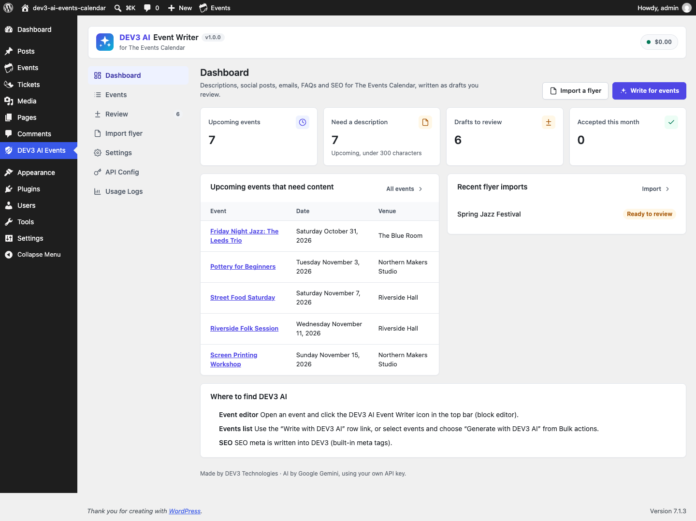

# DEV3 AI Event Writer for The Events Calendar

DEV3 AI writes event descriptions, social posts, emails, recaps, FAQs and SEO meta for The Events Calendar, and imports events from flyers.



## Features

DEV3 AI Event Writer is an add-on for the free The Events Calendar plugin. It works inside the TEC event editor (block editor sidebar and classic editor box) and on a bulk screen. Everything DEV3 AI writes is a draft: you see a diff against the current text, edit it, and accept or reject it.

* Event descriptions as native blocks (headings, paragraphs, lists). TEC's own date, venue, organizer and ticket blocks are kept.
* Social posts per network (X, Facebook, Instagram, LinkedIn, Threads, Bluesky, Mastodon) within each network's character limit, with live counters, copy and share links.
* Promo and reminder emails, and post-event recap emails that use Event Tickets attendance counts. Test send, send to attendees, optional automatic reminder.
* FAQ with FAQPage schema, shown on the event page, as a block or with [dev3ec_faq].
* SEO title and meta description, written into Yoast SEO or Rank Math, or printed by DEV3 when no SEO plugin is active.
* Import an event from a flyer or poster (image or PDF): DEV3 AI reads it, matches existing venues and organizers, and you create a reviewed draft event.
* Bulk generation in the background for many events, with a review queue.
* Works without AI: templates, manual editing, manual flyer entry.

Uses your own Google AI API key. No licence key, no account.

## Requirements

- WordPress 6.0 or newer (tested up to 6.9)
- PHP 7.4 or newer
- The Events Calendar (required)
- Optional: your own Google AI API key (from Google AI Studio) to switch on the DEV3 AI features. The rest of the plugin works without one.

## Installation

### From the release zip

1. Download `dev3-ai-events-calendar.zip` from the [latest release](https://github.com/dev3tech/dev3-ai-events-calendar/releases/latest).
2. In WordPress, go to **Plugins → Add New → Upload Plugin**, choose the zip and click **Install Now**.
3. Click **Activate**.

### Build from source

```bash
git clone https://github.com/dev3tech/dev3-ai-events-calendar.git
cd dev3-ai-events-calendar
composer install --no-dev
npm ci
npm run build
```

Then copy the `dev3-ai-events-calendar` folder into `wp-content/plugins/` and activate it.

### Getting started

1. Install and activate The Events Calendar (free). Event Tickets (free) is optional.
2. Upload the plugin zip in Plugins > Add New > Upload, then activate.
3. Open DEV3 AI Events > API Config and paste your Google AI API key.

## FAQ

### Does it publish anything by itself?
No. Every output is a draft until you accept it. Flyer imports create draft events.

### Is attendee data sent to the AI?
No. Recap emails only send counts (registered, checked in). Names and emails are used for sending only.

### Which editors are supported?
The block editor (TEC's "Activate Block Editor for Events" setting) and the classic editor.

## Privacy

Event details you choose to generate for are sent to Google AI with your API key. See the privacy policy text DEV3 adds under Settings > Privacy.

## Documentation

The full HTML guide (installation, settings, hooks and FAQ) is in [`docs/index.html`](docs/index.html). Open it in a browser after cloning or downloading the repository.

## Changelog

### 1.0.0
* Initial release.

## Licence

Released under the GNU General Public License v2.0 or later (GPL-2.0-or-later). See [LICENSE](LICENSE).

## More from DEV3

- [DEV3 AI Event Writer for The Events Calendar on the DEV3 Marketplace](https://www.dev3.tech/item/dev3-ai-events-calendar)
- [More WordPress plugins, themes and templates from DEV3](https://www.dev3.tech/marketplace)
